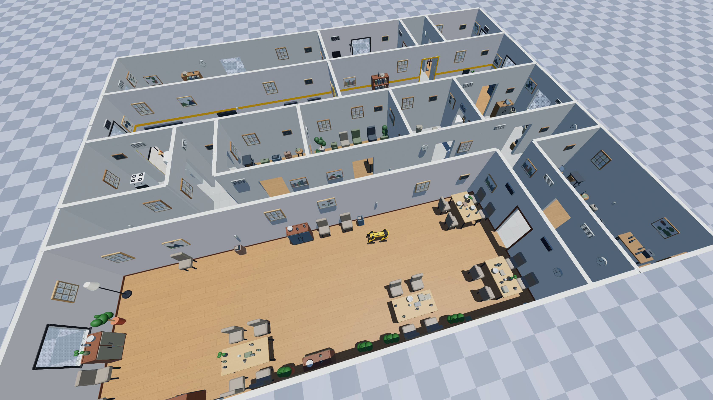
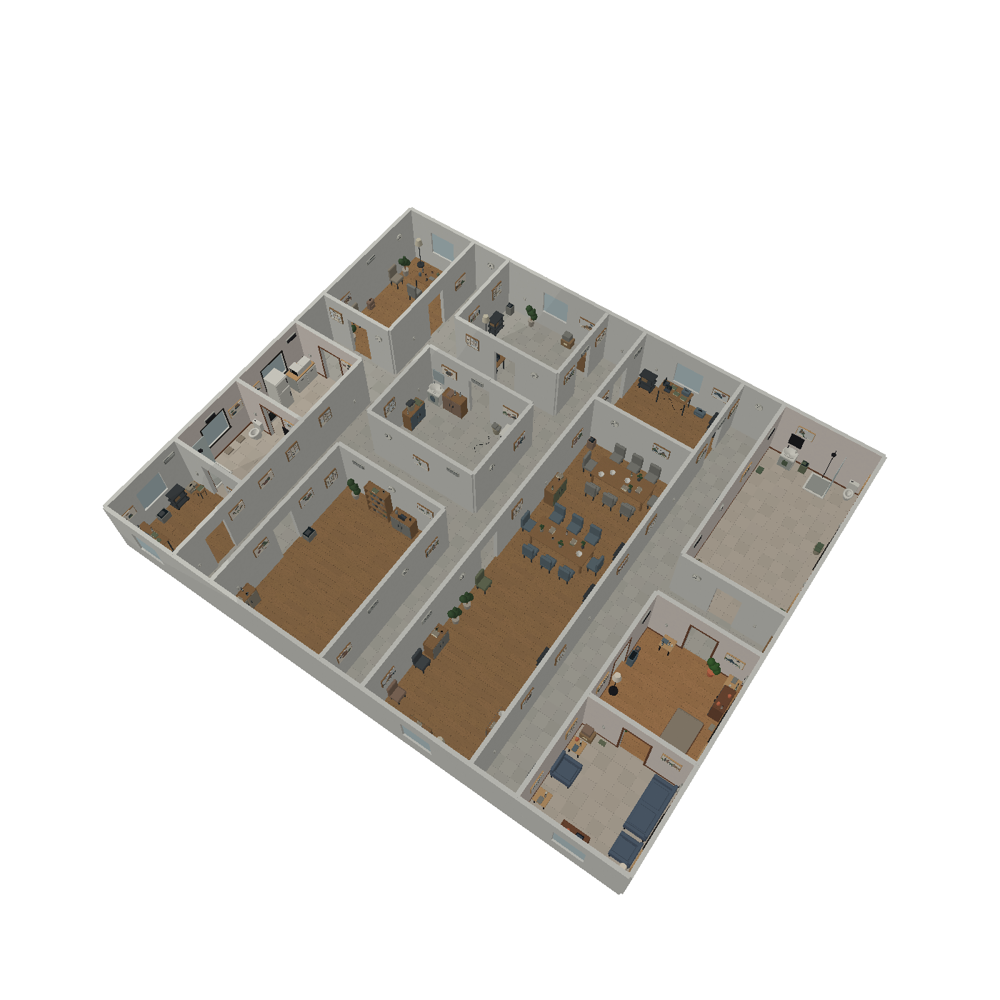
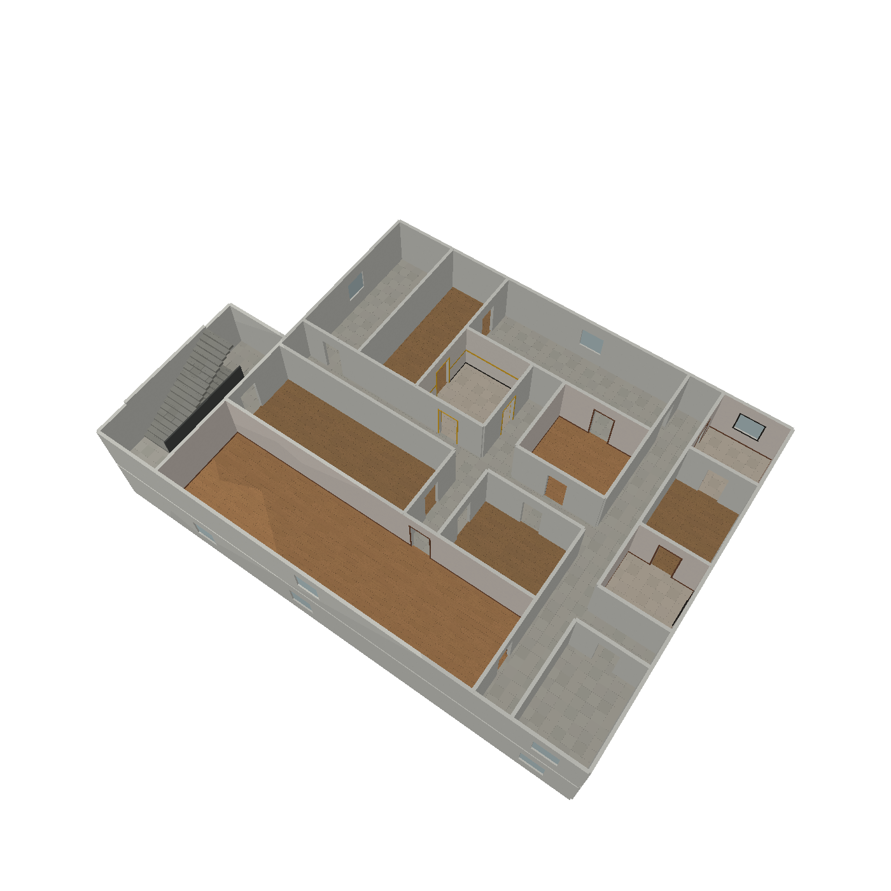
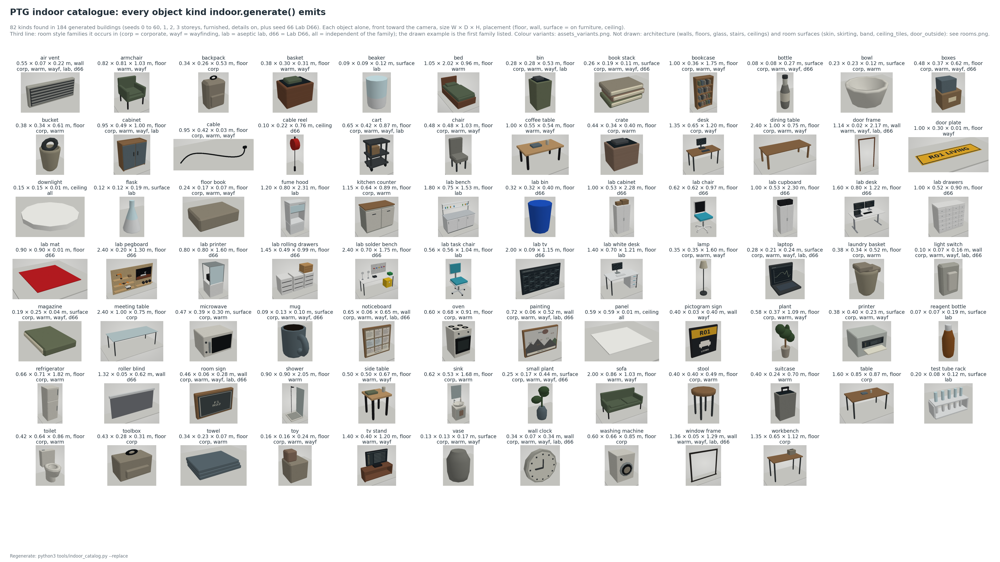
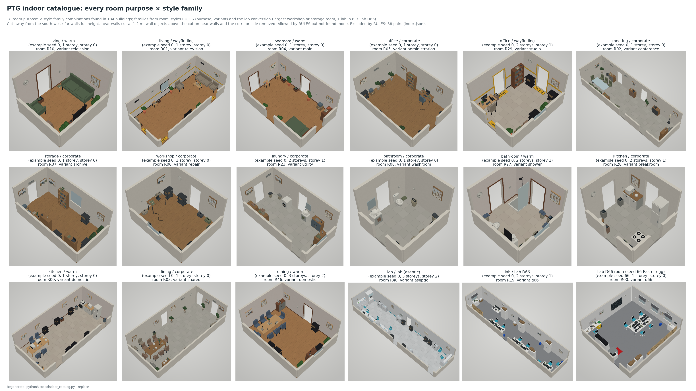
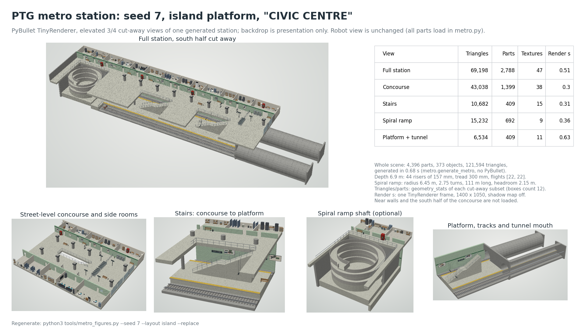

# pybullet-gazebo-ptg

Seeded procedural indoor environments (multi-storey buildings and metro stations) for PyBullet and Gazebo Sim,
with matching collisions in both simulators.



## Seeded indoor environments

A compact Python generator with a PyBullet viewer. All dimensions are metres, Z is up,
and every visible architectural element has static collision geometry. Layout and
placement use the standard library; Pillow builds procedural texture images and
PyBullet loads the simulation. The complete scene and texture assets are generated
before connecting to PyBullet. Rendering stays disabled while bodies are uploaded and the camera is
set, so the first rendered frame shows the finished environment.

```bash
./install.sh            # .venv with requirements.txt, then python3 selfcheck.py (about a minute)
python3 indoor.py --seed 7
python3 indoor.py --seed 7 --config my_settings.toml   # rooms, furniture, density...: see Configuration
python3 indoor.py --seed 42 --floors 3 --view-floor 0
python3 indoor.py --seed 42 --rooms 18 --width 28 --depth 22 --floors 2
python3 indoor.py --seed 7 --empty  # Architecture only.
python3 indoor.py --seed 7 --roof --view-floor 0  # Closed interiors when entering walk mode.
python3 indoor.py --seed 7 --plain  # Sparse furniture and flat materials.
python3 indoor.py --seed 7 --floors 3 --minimap  # Live floor-plan window beside the viewer.
```

`install.sh` builds a local `.venv`; `PYTHON=python3.11 ./install.sh` picks the interpreter. Where no
PyBullet wheel exists for that Python version, pip builds PyBullet from source (C++ compiler needed).
`selfcheck.py` generates a building and a metro station, loads both in PyBullet and runs two quick
test files (gap rule, minimap, settings). `indoor.py` and `metro.py` print a four-line banner when started from a terminal (never when
piped, logged or imported); `PTG_QUIET=1` turns it off.

Orbit with Ctrl + left drag, zoom with the wheel, and close the window to exit.
The viewer also supports:

| Key | Action |
| --- | --- |
| Tab | Switch between orbit and walk; return to the saved orbit camera |
| T | Toggle X-ray ("translucent"): every generated body, furniture included, becomes see-through |
| WASD | Walk forward/backward and strafe at 1.4 m/s |
| Arrow keys or right mouse drag | Look around in walk mode |
| 0 | Show all floors in orbit mode |
| 1 / 2 / 3 | Cut away above the ground / second / third storey in orbit mode |

Use `--xray` to start with X-ray enabled. Transparency uses the OpenGL viewer;
headless PNGs use the software renderer, which does not blend transparency.
X-ray colors distinguish storeys: blue, green, then orange; furniture and props blend
that tint with their own colour. Bodies not created by PTG (a robot) keep their colours,
so they are the only opaque objects. X-ray and cutaways only change visuals; walls and floors
still collide. X moved to T because host simulators often bind X/Z to camera zoom, and PyBullet's
default shortcuts (a c d g i j k l o p s v w) would clash in a host that keeps them enabled.
`xray.py` is reusable: `XRay(scene, body_ids, client, alpha=None).toggle()`; `alpha` takes a
float or a `{kind: alpha}` dict for renderers without blending (0 hides, 1 stays opaque).

`--minimap` opens a separate tkinter window (its own process, so drawing never waits on the
simulation) with the plan of each storey: rooms, corridors, landings, the annex, walls,
windows (blue), doors (green), open public passages (dashed) and stairs (yellow) with UP/DN
arrows. A red arrow shows the walker's position and heading while walking; orbit mode sends
nothing, so the arrow keeps the last walk pose. The storey follows the pose height; Up/Down
or the buttons show another storey, A returns to automatic selection. Any host can use it:
`mm = Minimap(scene); mm.update(x, y, z, yaw)` (yaw in radians, 0 = +x; at most 10 Hz,
non-blocking, harmless after the window is closed); `mm.close()`.
`python3 minimap.py --bench 20000` measures the viewer loop with and without it.
Walk mode starts in the spawn room and remembers your position between toggles.
It restores the full building while walking, including any floors hidden by a
cutaway. Its invisible 44 cm wide, 1.75 m high capsule uses collision queries,
wall sliding, gravity, and an 18 cm maximum step; it can traverse the real stairs.
The eye is 1.6 m above the feet. This is an inspection controller, separate from
your robot's physics and locomotion.

`--view-floor 0/1/2` hides higher geometry for inspection **without removing its
collisions**; omit it for robot camera runs. Floors are numbered from zero. The top
is open for inspection by default; use `--roof` to close it for mapping/sensor runs.

Generate reproducible artifacts without opening a window:

```bash
python3 indoor.py --seed 7 --headless --export out/seed7.json --render images/building_seed7.png
python3 indoor.py --seed 7 --empty --floors 3 --headless --view-floor 1 --render images/building_seed7_stairs.png
python3 -m unittest -v
```

All figures live in `images/`; each one is regenerated by the command shown next to it, except the overview at
the top (`ptg_overview.png`), a screenshot of a generated building with a robot model in a PyBullet session.





## Configuration (config/)

Rooms, furniture, density, style families, labs and the metro ranges live in five commented TOML files;
the generator reads them instead of built-in tables, and the shipped values reproduce the scenes exactly.

| File | Sets |
| --- | --- |
| `config/building.toml` | footprint, rooms per storey, storeys, wall/slab/door/window/stair dimensions, roof, furnished, details |
| `config/rooms.toml` | room purposes, small-room and largest-room rules, variants, style family per purpose/variant, lab conversion and the Lab D66 share |
| `config/furniture.toml` | furniture groups per purpose (and per variant), alternatives (`{any = [...]}`), free-standing groups (long tables), repeats, extras, fill items, `density`, `disabled` kinds |
| `config/clutter.toml` | small objects on furniture tops per purpose, slots per square metre |
| `config/metro.toml` | seeded metro envelope: train cars, depth, heights, column grid, widths, ballast and ramp shares, palettes |

Do not edit `config/` to experiment: write an override with only the keys to change, as a folder with
the same file names or as one file, and pass it with `--config` (CLI), `PTG_CONFIG` (any host
simulator) or `settings.use(path)`:

```toml
# my_settings.toml
[furniture]
density = 1.5                      # 50 % more fill items and clutter
disabled = ["toy", "floor_book"]

[furniture.groups]
office = [["desk", ["chair", 0, 0.45, 2]], ["bookcase"], ["plant"]]

[rooms.labs]
probability = 0.0                  # no laboratories
```

```bash
python3 indoor.py --seed 7 --config my_settings.toml
python3 settings.py my_settings.toml          # validate only
```

Tables merge key by key; lists replace the default. Unknown keys (with a "did you mean"), unknown object
kinds, malformed groups and purposes without furniture raise `ValueError`. A scene generated with
non-default settings records them in `scene["settings"]` (source and SHA-256); explicit `Config(...)`
arguments win over `building.toml`. Object kinds: `images/catalog_assets.png`.

## Catalogue: every object and room

`tools/indoor_catalog.py` generates seeds 0-60 x 1-3 storeys plus seed 66 and draws what
`indoor.generate` really emits: 82 object kinds, one tile each (`images/catalog_assets.png`; style
family variants in `assets_variants*.png`), and the 18 room purpose x style family combinations that
`room_styles.RULES` allows, as cut-aways (`images/catalog_rooms.png`). `reports/catalog_index.json`
records where each example came from and which 38 combinations the rules exclude.

```bash
python3 tools/indoor_catalog.py --replace     # about 2 minutes
```




## Procedural furniture

Furniture is enabled by default; `--empty` or `Config(furnished=False)` disables it.
`furniture.py` builds restrained low poly models with chamfered panels, rounded
cushions, twelve-sided turned legs/pots/bottles, curved mug handles and ellipsoid
foliage. Models have physical collisions and real metric dimensions: seats at about 45 cm, desks/tables at 75 cm,
and bookcases at 1.75 m. External models and image downloads are not needed.

Every model is shown in `images/catalog_assets.png` (Catalogue, above).

Each floor gets a seeded mix of living rooms, offices, bedrooms, storage, bathrooms,
kitchens, laundry rooms, workshops and meeting rooms, with seeded use variants.
Default 12-room storeys include at least a bathroom and kitchen; the room program
is planned before furniture, so wet-room floors stay tiled with `--empty` too.
A large enough room becomes a dining space. Placement uses coherent groups: chairs
face tables; desk chairs tuck under desks; sofas face into the room with coffee
tables in front, and TV stands prefer the opposite wall. Beds, bookcases and
cabinets sit against walls. Larger dining rooms/offices/storage rooms can receive
multiple tables, workstations or shelves. Plants, lamps, books, toys and stacked
boxes add visual variety; books and mugs also sit on tables.

Bathrooms have a WC with cistern and open bowl silhouette, a vanity basin, mirror,
faucet, toothbrush cup and towel; some include a shower. Kitchens have cabinets,
a refrigerator, stove/oven and a countertop microwave when placement fits.
Laundry rooms use front-loading washers and laundry baskets. Workshops use benches,
toolboxes, carts and backpacks. Surface clutter follows the room's function.


Loose power cables sit under or alongside desks and equipment. Each cable uses a
small six-sided swept mesh with static triangle collision, not a convex slab filling
its bends. Cables avoid the 90 cm travel lanes, doors and stairs. All objects remain
static; articulated fixtures and cable dynamics are not included.

Every group must fit inside its room, avoid other groups, and preserve **90 cm
clear travel lanes** from every doorway to a central room hub. The spawn stays
clear. Corridors, stair flights and landings receive no furniture. If a group does
not fit, placement tries other walls and then a smaller version; it skips the
group if clearance cannot be maintained. All furniture and props are static in
this first version, including small objects on the ground.

Furniture uses a separate seeded random stream, so toggling it does not change the
building's rooms, doors, windows or stairs. X-ray makes furniture translucent too.
Walk mode collides with the furniture. JSON `objects` records room ownership, group items, pose, footprint and
part indices; each part also has an `object_id` and a semantic model `label`.
`clear_paths` records the reserved room connections.

## Visual detail for mapping

Detailed mode is now the default. `--plain` / `Config(details=False)` restores
sparse furniture and flat materials; curved geometry stays enabled. It leaves the architectural layout
unchanged. The seed 7 single-storey example without a roof has **449 model instances versus 75**
in the sparse baseline (about 6×), including 192 mounted landmarks, 106
supported props and four cables. `detail_stats` exports these counts; individual mesh/box parts
are not counted as separate objects. Counts vary with the seed and available space.

The added cues include:

- One building wall paint on the structural walls and corridors, plus a per-room
  **style family** (corporate, warm, wayfinding, lab; see "Room style families" below)
  that tints the room side through 3 mm wall skins. Circulation and wet rooms use 50 cm
  ceramic tiles; dry rooms mostly use staggered 1 m × 25 cm oak planks.
- Subtle neutral material images for every opaque surface: wood grain, fabric weave,
  cardboard and plain painted finishes. Images are shared by the whole building; a
  family changes tints, never adds per-room material images.
- Unique framed cityscapes, botanical images, landscapes and abstract paintings;
  noticeboards and readable room/floor signs, all in muted inks. Physical vents,
  switches and round clocks provide additional wall landmarks, including hallways.
- More floor objects and furniture, including bins, baskets, carts, crates and
  suitcases. Bottles, mugs, books, plants, laptops and printers sit on actual tables,
  cabinets and shelves, with overlap/support checks.
- Four restrained monitor/TV interfaces: workspace, report, file browser and calendar.
  Displays use one UV-mapped face, separated from the bezel by 2 mm, with the monitor
  post behind it. This prevents coplanar surfaces from fighting in the depth buffer.


### Room style families (room_styles.py)

Each room gets one of four finish families from its use; corridors and landings stay
corporate. Where two families fit, a per-room seeded choice picks one
(`Random(f"{floor_seed}:room_style:{room_id}")`).

| Purpose (variant) | Family |
|---|---|
| office (administration), meeting, storage, workshop, laundry, bathroom (washroom), kitchen (breakroom), dining (shared) | corporate (today's look) |
| bedroom (any), bathroom (shower), kitchen (domestic), dining (domestic) | warm |
| living (reading or television) | warm or wayfinding |
| office (studio, i.e. a private office) | wayfinding or corporate |
| lab | lab |

- **warm**: warm paint and floor tint, walnut skirting and door architraves, dark window
  surrounds with a sill board, walnut/oak/charcoal furniture tints, terracotta pots.
- **wayfinding**: the warm base plus a yellow band (1.05 to 1.17 m), a dark base line,
  yellow architraves on both faces of corridor doors, a door plate with the room code
  just inside each door, and a pictogram sign (code, pictogram, purpose) on the corridor
  side of the first corridor door. Never a bedroom.
- **lab**, two variants. The labs of a building, in (storey, id) order, cycle through six
  slots from a seeded offset (`Random(f"{seed}:lab_d66")`); slot 0 is **Lab D66** and the
  other five are the **aseptic lab**, so any six consecutive labs hold exactly one D66 and a
  building has at most one.
  - aseptic: white walls, light grey tile, cyan skirting, light grey frames; long white
    benches with reagent shelves, white desks, rolling task chairs with cyan cushions,
    fume hoods, test-tube racks, beakers, flasks and reagent bottles.
  - Lab D66 (Easter egg: the robotics lab where PTG was born; its room sign reads
    "LAB D66"): white walls, grey vinyl-look floor, grey roller blinds over the windows, a
    0.5 m tile ceiling layer and red cable reels wherever a ceiling exists, white bench
    desks on grey steel frames in pairs with dual monitors and a laptop, task chairs with a
    cyan seat, white 5-star base on casters and dark mesh back, a birch pegboard with
    shelves, robot models (quadcopter, rover, arm, wheels) and a space poster, tall white
    double-door cabinets with boxes on top, a white chest of small drawers, a blue bin.
    Seed 0 with 3 storeys has one, on storey 1.

**Seed 66 is Lab D66 itself.** `Config(seed=66)` no longer yields an ordinary building: it
builds one 9.0 × 8.6 m room from the lab's floor plan, plus a short corridor stub
outside its door so the doorway leads to a floor. Plan (north = top of the sketch): desk
and soldering station (white pegboard, cable spools, magnifier lamps, yellow flammables
cabinet) in the north-west corner; a 2 m wall screen on the north wall; the door in the
south part of the west wall, with a 3D-printer enclosure, a red foam mat and two tall
cupboards with black boxes north of it; two white cabinets in the south-west; two birch
pegboards with white rolling drawer units along the south wall; four white desks in a
2 × 2 cluster with three chairs north and two south (plus one at the soldering bench);
windows with grey roller blinds on the east wall, opposite the door. `rooms`, `floors`,
`width` and `depth` are replaced (1 room, 1 storey, 9.0 × 8.6 m) and the effective values
are exported in `scene["config"]`; `roof`, `furnished` and `details` behave as usual
(the tile ceiling and cable reels appear with `roof=True`). There is no loop route (one
room). No baseline configuration uses seed 66; the default seed stays 0.

Labs: after `assign_rooms` has drawn every purpose and variant, each storey converts its
largest workshop or storage room (both sides at least 3.3 m) into a lab with probability
0.6 (`Random(f"{floor_seed}:lab")`). All other purposes, variants and furniture stay
identical (furniture uses one RNG stream per room). Finish parts are appended after
everything else, so earlier box indices do not move; surface clutter and cables in later
rooms can still differ, because their RNG streams are keyed by box and object index and
the lab's own furniture changes those counts.

Architecture is unchanged: `tools/baseline.py check` reports "layout same" for every
configuration. Skins, skirting, bands and frames are kinds `wall_finish` and `frame`,
outside the baseline's architecture set; they stop at every door and window opening.
Wall landmarks keep their 4 mm offset in front of the 3 mm skins. Lab lighting targets
500 lx (EN 12464-1 laboratories). COCO hints: both task chairs = chair, reagent bottle =
bottle; the other lab items stay unmapped. `room_styles.ENABLED` (environment variable
`PTG_ROOM_STYLES=0/1`) switches the families off/on, e.g. for before/after renders.

`surfaces.py` produces deterministic 512 px textures in `assets/procedural/` and
caches them. Base material images are grayscale albedo detail multiplied by the
palette colour; artwork and displays are explicitly printed colour content.
Identical materials share the same texture asset across rooms and floors.
Metric UVs repeat materials at their physical scale: for example,
tiles are 50 cm rather than stretching a single image across an entire room.
Artwork fits its frame. The texture specification is exported with each box so
images can be recreated when moving a scene to another backend.

Textures are applied to the actual visual meshes, including ordinary
`p.getCameraImage` RGB output. They are not screenshot overlays. Collisions remain
solid boxes for architecture and conservatively for chamfered furniture; curved
parts use convex mesh hulls, except the swept cable mesh. Small cavities such as mug handles are filled in the
collision approximation. Wall decorations mount only on supporting wall segments, leaving door
and window holes open; floor placement still reserves the 90 cm travel lanes.
Use `roof=True` / `--roof` for closed interiors when recording mapping data, with
X-ray/cutaways off for the robot camera. The generated visual cues have been checked
in RGB renders; SLAM/VLM localisation accuracy is not measured by these geometry tests.

## Geometry and connectivity

The building is partitioned into rectangular rooms, sometimes separated by full-width
corridors. A random spanning tree opens shared boundaries; at least one additional
edge closes a **simple cycle on every storey**, for every successfully generated
seed, including with `--loops 0` / `Config(loops=0)`. The loop has at least three
distinct spaces and physical openings. Extra openings retain the configured `loops`
probability.

When the partition is a tree (including one-room and strip layouts), two connected
return-corridor sections extend the east facade by 1.76 m with default dimensions.
They have real slabs, walls, doors and optional ceilings. This makes a cycle possible
without changing the requested room count. `bounds` includes the annex.
Dimensions that cannot provide clear openings produce an explicit error.

`scene["loop_routes"]` exports one witness per storey: the closed space-ID sequence,
portal indices, a closed route of metric XYZ points through the reserved hubs/door
approaches, its length and the floor graph's `cycle_rank`. These are ground truth
for inspection and evaluation. Each loop is reachable from the spawn.

Every room, corridor and landing is reachable from the spawn room, including
the upper storeys. The room count applies **per storey**, excluding corridors and
landings. Impossible room counts or dimensions produce an error rather than silently
reducing the requested count.

Each storey has its own deterministic seed, exported as `floor_seeds`, and is
partitioned independently rather than copying another storey's floorplan. The
stairwell stays aligned between storeys. Tests compare room layouts across all
three storeys for 100 building seeds. A one-room or geometrically constrained
footprint can necessarily share room boundaries between storeys.

| Element | Default dimensions |
| --- | --- |
| Main footprint | 22 × 18 m |
| Room | At least 3.2 m clear along each axis; size varies with partitions |
| Corridor | 1.6 m clear |
| Walls / slabs | 0.16 / 0.15 m thick |
| Doorway | 1.0 m clear × 2.1 m high, unframed, open, zero threshold |
| Window | 1.2 × 1.2 m, sill 0.9 m above the floor, collidable glazing |
| Storey | 3.0 m floor to floor, 2.85 m clear ceiling height |
| Stairs | 0.15 m rise, 0.28 m tread, at least 1.6 m clear width |
| Stair guard | 1.1 m high |

These are realistic simulation defaults, not a building-code certification. Door and
circulation dimensions are above the [US Access Board doorway and route minimums](https://www.access-board.gov/ada/guides/chapter-4-entrances-doors-and-gates/);
stair dimensions follow its [riser/tread guidance](https://www.access-board.gov/ada/guides/chapter-5-stairways/).
Room sizes and window dimensions are design choices, not universal standards.

For two or three storeys, a 3.52 × 8.84 m enclosed stairwell extends from the west
side of the footprint. Each level has two landings joined by a return corridor.
Straight flights stack in the same direction, leaving headroom over the lower
flight. Upper slabs have actual stair openings; individual solid treads provide
step collisions. The twentieth riser reaches the upper landing. Guard walls protect
the corridor and unused ends of the stair opening. Changing storey height changes
the number of risers so that they remain at most 15 cm high.

Doors and windows have no decorative borders or frames. Doors are open apertures;
there are no articulated leaves or door-opening
controls yet. The geometry uses rectangular rooms and straight walls. Procedural
furniture is a placeholder for your supplied models.

## Use in an existing PyBullet simulation

Add the scene to an existing PyBullet connection; the loader does not reset the world,
change its gravity, or step it:

```python
import pybullet as p
from indoor import Config, generate, load_pybullet

scene = generate(Config(seed=42, rooms=12, floors=3, roof=True))
from surfaces import prepare_textures
prepare_textures(scene)
client = p.connect(p.GUI)  # Or use your simulator's existing client.
body_ids = load_pybullet(scene, client=client)
p.setGravity(0, 0, -9.81, physicsClientId=client)
# Load your robot/controller here, in the room at scene["spawn"][:2].
# scene["spawn"][2] = 0.55 m is a hint: adapt it to the robot URDF base origin.
```

The current `apartment_office` environment targets visual inspection and mapping
work. The generator does not include a robot model, camera calibration or
locomotion policy. The 65 cm preview camera is illustrative, not a calibrated
sensor mount. Tests sweep a
60 cm wide/tall collision proxy from each space through every portal, check the
support below routes, ray-test stair treads/headroom, and drop a dynamic body onto
the floor. This verifies architectural clearances and collisions; actual stair
climbing still needs validation with your robot and controller.

`body_ids[i]` corresponds to `scene["boxes"][i]`, so PyBullet segmentation body IDs
can be mapped to architectural kinds and storeys. `spaces` records room bounds,
`portals` records connected space IDs and clear openings, and `stairs` records
inter-storey links and dimensions. These are ground-truth metadata, not inputs to
the robot's mapping model unless you explicitly choose to use them.

## Gazebo Sim

`gazebo.py` writes any generated scene as a Gazebo Sim world (Harmonic, SDF 1.11); the same files also load in
PyBullet, so one export serves both simulators:

```bash
python3 gazebo.py --seed 7 --out exports/building_seed7          # building (same options as config/building.toml)
python3 gazebo.py --metro --seed 7 --out exports/metro_seed7     # metro station
GZ_SIM_RESOURCE_PATH=$PWD/exports/building_seed7 gz sim -r exports/building_seed7/world.sdf
```

```python
from gazebo import export_sdf, load_export
export_sdf(scene, "exports/my_scene", name="my_scene")   # any scene from indoor.generate or metro.generate_metro
collision_ids, visual_ids = load_export("exports/my_scene", client)   # the same files in PyBullet
```

| File | Content |
|---|---|
| `world.sdf` | Gazebo's default empty world (physics with DART's bullet collision detector, user commands, scene broadcaster, sensors, IMU, contact, sun) including the model |
| `<name>/model.sdf`, `model.config` | one static model, one link: a collision per architectural part (`c<i>_<kind>`, i = index in `scene["boxes"]`), one concave mesh per storey and kind for the objects (`m<level>_<kind>`: furniture, landmarks, props; `gazebo.collision_groups`) and the merged visuals |
| `<name>/meshes/*.obj`, `textures/*.png` | collision meshes (one per distinct architectural shape, one per object group), merged visual meshes (UVs, normals), their texture images |
| `scene.json` | the scene JSON: spawn, spaces, portals, stairs, clear paths, objects, semantics |

What is identical in both simulators, by construction: every collision shape and pose (boxes; for turned and
rounded parts the exact convex hull of their vertices, computed with SciPy's Qhull and written as a mesh, because
Gazebo's `<mesh optimization="convex_hull">` is a V-HACD voxel approximation that rested test spheres up to 8 mm
higher; concave trimeshes for cables; all chosen by `indoor.collision_shape`, which `load_pybullet` uses too; the
objects' boxes and hulls are written as the triangles of one concave mesh per storey and kind, because Gazebo's
DART plugin visits every collision shape at every 1 ms step and 2,100 separate object shapes cost a third of real
time with a quadruped in the building), friction 0.8 and no restitution, the visual meshes, UVs,
colours and textures, and the scene metadata. What differs: the physics engines (Bullet in PyBullet; DART or
bullet-featherstone in Gazebo) solve contacts differently, and the renderers (PyBullet's OpenGL/TinyRenderer,
Gazebo's ogre2 PBR) shade differently. Place the robot at `scene["spawn"]` (0.55 m is a base-height hint); the world
has no ground plane, since every scene has its own floors.

Checks (`exports/` is git-ignored):

- `python3 tools/gazebo_parity.py EXPORT` loads `scene.json` with `load_pybullet` and the exported files with
  `load_export`, then compares every collision's AABB (a merged mesh against the union of its parts'), a vertical
  and horizontal ray grid (a merged mesh within 5 mm: Bullet casts rays at a convex hull a few mm off and at its
  triangles exactly, so rays grazing a hull's silhouette are re-cast 5 mm aside) and a rendered image.
- `python3 tools/gazebo_probe.py make EXPORT`, then `gazebo` (inside a Gazebo installation, with the gz-sim Python
  bindings) and `check`: spheres released on flat surfaces must rest at surface + radius in every engine.

Measured on 2026-10-26 with Gazebo Sim 8.15 (Harmonic): the reloaded exports match the native scenes (building
seed 7: 2,633 parts in 304 collisions, 6,821 rays, rendered image; building seed 0: 2,374 parts in 274 collisions;
metro seed 7: 4,184 parts in 1,410 collisions, 65,054 rays, image). Probe spheres (r = 5 cm, one per part, 67 on
seed 0 and 71 on seed 7) rest within 0.01 mm in PyBullet and 1.00 mm in Gazebo with both DART and
bullet-featherstone. Collision meshes carry vertex normals because Gazebo's DART plugin ignores meshes without
them. Speed, a quadruped (Spot, ros2_control at 1 kHz) standing in building seed 0 under DART, real-time factor:
0.18-0.30 with one collision per part and the default (ODE) detector, 0.63-0.73 with the bullet detector, 1.00
with the bullet detector and the merged object meshes (the same robot in an empty-room world: 1.00).

## Ceiling lighting (pybullet_pbr only)

`lights.py` adds ceiling luminaires for the custom `pybullet_pbr` renderer
([pybullet-pbr](https://github.com/GiorgioClivio/pybullet-pbr), built from source with `./build.sh`), whose sun
cannot reach covered storeys. It is never called by `generate()`; add it only when that
renderer is active (`lights.active_pbr()`), before `load_pybullet`, so the parts land at
the end of `scene["boxes"]` and existing body indices do not move:

```python
import lights
if lights.active_pbr():
    lights.add_lights(scene)            # idempotent; stores scene["lights"]
body_ids = load_pybullet(scene, client)
manager = lights.PbrLightManager(scene, client=client, body_ids=body_ids)
manager.update(robot_xyz)               # each step; reassigns only after 0.25 m or a room change
```

Only spaces with a slab or roof above get fixtures (the top storey of a roofless building
gets none). Each one is sized by the lumen method, N = E × A / (F × UF × MF), with
MF = 0.8 and UF taken from a real ceiling-mounted LED downlight table at the room index.
Fixtures sit on a regular grid with spacing ≤ 1.5 × mounting height and are dimmed so
the maintained average is exactly the target below, not more. `python3 lights.py --seed 7
--floors 3` prints the per-space calculation.

| Use | Em (lx) | Plane | Luminaire | K | Source |
| --- | --- | --- | --- | --- | --- |
| office, meeting | 500 | 0.85 m | 3600 lm 595 mm panel | 4000 | EN 12464-1 ([DIALux](https://dialux4.support-en.dial.de/support/solutions/articles/9000080374-standard-values-for-office-interiors), [AV](https://www.av.se/en/indoor-environment/light-and-lighting/office-lighting/)) |
| workshop | 300 | 0.85 m | panel | 4000 | unverified: no EN row opened |
| laundry | 300 | 0.85 m | 1000 lm downlight | 4000 | EN 12464-1 textile washing/ironing ([DIALux](https://dialux4.support-en.dial.de/support/solutions/articles/9000080858-standard-values-for-the-textile-industry), search listing only) |
| kitchen | 300 | 0.85 m | downlight | 4000 | IES residential 30–40 fc ([Penn State](https://courses.ems.psu.edu/egee102/node/2363)) |
| dining | 200 | 0.85 m | downlight | 3000 | EN 12464-1 canteens ([DIALux](https://dialux4.support-en.dial.de/support/solutions/articles/9000080379-standard-values-for-restrooms-sanitary-areas-and-first-aid-points-)) |
| bathroom | 150 | 0.85 m | downlight | 4000 | SLL LG9 ([Thorlux](https://www.thorlux.co.uk/applications/social-housing/kitchens)) |
| living, bedroom | 100 | 0.85 m | downlight | 2700 | IES residential 10–20 fc ([Penn State](https://courses.ems.psu.edu/egee102/node/2363)) |
| storage | 100 | floor | downlight | 4000 | EN 12464-1 store-room aisles ([DIALux](https://dialux4.support-en.dial.de/support/solutions/articles/9000080302-standard-values-for-conventional-warehouses-and-stores)) |
| corridor | 100 | floor | downlight | 3000 | EN 12464-1:2021 ([Glamox](https://glamox.com/en/pbs/application-guide/education/communal-and-circulation-areas-for-education)) |
| stair landing | 150 | floor | downlight | 3000 | EN 12464-1:2021 stairs ([Glamox](https://glamox.com/en/pbs/application-guide/education/communal-and-circulation-areas-for-education)) |

UF values come from a [Philips DN027B UF table](https://www.signify.com/api/assets/v1/file/Signify/content/Downlight_DN027B_G3_LED6_NW_6W_D90_RD-GUL/General_uniform_lighting___DN027B_G3_LED6_NW_6W_220_240V_D90_RD.pdf)
(reflectances 0.70/0.50/0.20), applied to panels too. Below room index 0.6 (corridors)
the table is extrapolated linearly. The downlight is the [Philips SmartBright DN029B](https://lighting.philips.com/api/assets/v1/file/Signify/content/929002576508_EU.en_AA.PROF.FP/product_leaflet_caption.pdf)
(1000 lm, 3000 K, 100°). SHR ≤ 1.5 and the colour temperatures are rules of thumb, not standards.

`pybullet_pbr` has 8 light slots and a 16-tile shadow atlas. The manager fills the slots
it finds free (a robot headlamp created earlier is left alone) with the fixtures that
matter most: same storey first, then same space, then nearest. Each is a downward
shadowed spot costing 1 tile, so light does not leak through walls or slabs. Fixtures
outside the 8 still glow (emissive material) but do not light anything. Spot intensity
is set in candela to conserve the fixture's real flux; the renderer's own lumen
conversion spreads flux over a full sphere. Exposure defaults to `"room"`: a fixed EV for
the current space's target lux. This avoids the renderer's whole-frame auto-exposure,
which bright luminaires in shot would pull down. `exposure="auto"` or `None` are also
available. The renderer has no inter-reflections, so rendered illuminance is below the
UF-based average. This has not been checked in a real render: on 2026-10-20 the headless
EGL plugin crashed while loading PTG meshes.

## Perception coverage and asset budget

The new WC, basin, fridge, oven, microwave, bowl and backpack silhouettes target
familiar object categories. `semantics.py` maps supported model names to the
[COCO80 taxonomy used by common pretrained YOLO models](https://github.com/ultralytics/ultralytics/blob/main/ultralytics/cfg/datasets/coco128.yaml).
JSON items carry `coco_id` / `coco_class`; `perception` reports class counts and
unmapped models. This is semantic ground truth, not a detector result. For example,
cables, showers and washing machines have no corresponding COCO80 class here and
are deliberately left unmapped. No detector, weights or training dataset is bundled.
Actual YOLO/VLM recall and SLAM loop-closure performance still require evaluation
using the robot cameras and chosen models; low poly geometry alone does not establish
recognition accuracy.

Base materials share texture files; the procedural model catalog is Python code.
The generated PNG cache is limited to **64 MiB on disk**. Preparing a scene pins
all images it needs, then removes the oldest unneeded generated PNGs. Images for
old seeds can be recreated from JSON. User-supplied assets are never removed by
this cleanup. An individual scene exceeding the texture budget raises an error.
The limit counts allocated filesystem blocks as well as file contents.
This keeps the code and generated assets well below 1 GB across repeated runs.
Example JSONs/renders, future supplied assets and installed dependencies are separate
from the generated-cache limit. The workspace including examples and the cache was
about 75 MB when this revision was validated.

Validation: 28 automatic tests cover geometry, monitor segmentation in four
orientations, room diversity, grounded cables, collision clearances, three-storey
stairs, the physical return corridor, and cache eviction/regeneration. An additional
stress check generated 10,000 seeds with three storeys and `loops=0`: all 30,000
storeys were connected and contained a simple cycle.

## Textures, furniture, and Gazebo

Pass `textures="path/to/materials"` to `load_pybullet`, or use `--textures` in the
viewer. Available architectural filenames are `wall.png`, `floor.png`, `stairs.png`,
`trim.png`, and `glass.png`. Furniture also supports `wood.png`, `metal.png`,
`fabric.png`, `leaf.png`, `ceramic.png`, `screen.png`, `paper.png`, `plastic.png` and
`cardboard.png`; these override generated materials of the same name. Missing files
use the procedural image, or the base color where no procedural material is defined.
Architecture uses metric box UVs; turned furniture uses cylindrical UVs and
chamfered panels use planar UVs. Plain mode disables generated textures.

Later your URDF/mesh models can replace the procedural placeholders at the exported
object poses, respecting the same footprints and clearance rules. You can also add
your own models through the same PyBullet client after loading the building. No
external furniture meshes are bundled.

JSON exports contain the configuration, spaces, portals, stair links, spawn, bounds,
and all part sizes/centres/material names/colors/texture and shape specifications, furniture instances and reserved
paths. This simulator-independent scene is what `gazebo.py` exports (section "Gazebo Sim"): the physical
building is reproduced without rerunning the layout algorithm. Seeds reproduce layouts with the same generator version/config;
save JSON when an environment must survive future algorithm changes.

`styles.py` owns the common palette and the implemented `apartment_office` profile;
`geometry.py` owns reusable lightweight shapes. `scene["style"]` records the profile
and `geometry_stats` records the visual triangle count (122,890 for the seed 7
single-storey example). See [STYLE_GUIDE.md](STYLE_GUIDE.md) for the visual rules,
geometry budget and extension contract. A metro station is implemented in `metro.py` (below); cave
environments are planned, and neither is made by simply recolouring this apartment generator.

### No z-fighting: the 5 mm gap rule (geometry.separate_coplanar)

Two same-facing flat faces closer than 2.5 mm that share visible area flicker in a depth buffer
(signs on kiosks, door frames on wall skins, stacked finishes). Every generator (`indoor.generate`,
the Lab D66 scene, `metro.generate_metro`) ends with `separate_coplanar`, which sets such faces 5 mm
apart (`ZFIGHT_GAP`, the same as the ceiling skin):

- architecture (walls, floors, ceilings, stairs) never moves for an object or a finish; otherwise the
  smaller face moves, larger faces first, so stacks step out instead of trading places;
- a part's main face (a sign's front, a skin, a jamb) steps out; edge and horizontal faces step back,
  so door and window openings stay clear; floors and treads never rise;
- shared areas pressed against or inside another part are hidden and left alone; designed offsets
  (3 mm skins, 4 mm boards) are kept; parts of different storeys are never compared;
- only visuals change: a moved part keeps its generated collision box in `collision_center` and
  `collision_size`, which `load_pybullet` uses, so physics is identical.

`python3 tools/zfight_audit.py` counts the remaining pairs per part kind; `python3 tools/gap_effect.py`
measures growth, shift and floor lips against the scene without the rule; `test_zfight.py` checks it.
On 2026-10-20: building seed 0 (2 storeys) 4,707 pairs before, 8 after; metro seed 1 2,073 before, 0 after;
Lab D66 340 before, 4 after; no floor rise; at most 15 mm per face.

The room/door graph and deterministic seed approach is inspired by
[BenPyton/ProceduralDungeon](https://github.com/BenPyton/ProceduralDungeon), an Unreal
plugin based on assembled room levels. This implementation uses fresh BSP layouts
and primitive physical geometry and does not require Unreal or that plugin.

## Metro station (metro.py)

A second environment, explored top-down: the robot spawns in a street-level concourse
(floor z = 0) and goes down stairs, or an optional spiral ramp, to the platform level
(floor z = -depth) with tracks and tunnels.

**Seeded envelope.** `MetroConfig` fields left at `None` are drawn from the seed; explicit values are
kept and do not shift the other draws. Ranges: trains of 4-8 cars of 15, 16.5 or 18 m (platform capped
at 140 m) [car lengths and the 5 m stopping margin are design values], depth 6-12 m, concourse height
4.5-7 m, column spacing 7.5-10.5 m, side-room depth 4-6.5 m, stair width 2.4-3.4 m, island 8-12 m or
side platforms 5.5-7.5 m, ballast track bed in 30 % of seeds, spiral ramp in 50 %, and one of the
`PALETTES` colour schemes. `tools/metro_figures.py --survey 0-9 --layout auto` tabulates seeds.
The numbers below describe the seed 7 station as it was before the seeded envelope (fixed 80 m,
9 m grid, 7.5 m depth); seed 7 today: island, 65 m platforms, 8.2 m grid, 6.9 m depth, ramp,
4,193 parts, 347 objects, 121,446 triangles, 0.54 s. It is metric, Z up and seeded,
and every visible part has static collision. Impossible configurations raise a
`ValueError` that says which limit was hit. `metro.generate_metro(MetroConfig(...))`
returns a scene in the **same schema** as `indoor.generate`, so `indoor.load_pybullet`
and `viewer.Viewer` load it unchanged. Rotated parts (spiral ramp decks, stair
handrails, tunnel lining segments) use the optional xyzw `orientation` key.

```bash
python3 metro.py --seed 7                                  # GUI, orbit/walk as indoor.py
python3 metro.py --seed 7 --layout side --no-ramp --headless --export x.json --render x.png
python3 metro.py --seed 7 --headless --figures out/metro       # standard RGB views
python3 tools/metro_figures.py --seed 7 --layout island --replace   # cut-away diorama figure
python3 -m unittest test_metro -v
```



What it builds (seed 7 defaults: 3,383 parts, 268 objects, 120,872 visual
triangles, generated in about 0.2 s without PyBullet):

- **Concourse, level 1:** a column-lined hall (two rows of 1.15 m round columns with
  flared capitals on a 9 m grid), a glazed east facade, side rooms in two strips
  (ticket office, kiosk, staff room, toilets, storage, first aid, equipment, office,
  cleaner) with doors, signs and catalogue furniture. A gateline splits the hall into
  unpaid and paid spaces: 0.6 m gate aisles plus one 1.0 m wide aisle, which is the
  robot route and the only portal between the two spaces. Ticket machines, benches,
  bins, plants, line maps, noticeboards and wayfinding totems stand against walls.
- **Vertical circulation:** two straight stairs, each 3.0 m clear, with 47 risers of
  160 mm on 300 mm treads, in flights of 16/16/15 with 2.0 m landings, a 28.0° pitch,
  and handrails, mid rails and posts on both sides. The concourse void above each
  stair is open and guarded. With `spiral_ramp=True` (default), a helical ramp drops
  in a square shaft at the west end. The tracks then end at buffer stops (terminus),
  and a cross passage at platform level links the shaft door to every platform.
- **Platform level, level 0:** an island platform (10 m) or two side platforms (6 m
  each, with a column row between the tracks), chosen by the seed with `layout="auto"`.
  It has a coping with a refuge recess, a 0.61 m tactile strip, benches, bins, hanging
  platform/exit signs, departure boards, clocks, station-name boards and line maps.
  Each track has 60E1 rails (foot, web, head), monoblock sleepers every 0.60 m, a
  conductor rail on insulators, and a concrete or ballast bed. Tunnels run 30 m from
  each open end of the station. The island layout uses two single-track bores, 5.8 m
  internal diameter, with 24 rotated lining segments and segment-ring textures. The
  side layout uses a double-track box tunnel. Every tunnel has an emergency walkway at
  platform height that continues the platform. Each tunnel ends at a bulkhead, which
  marks the end of the generated geometry, not a real tunnel end.
- **Ground truth:** `spaces` lists the concourse halves, rooms, platforms, walkways,
  cross passage, ramp shaft and trackways. Each space has `level`, `rect`, `floor_z`
  and `traversable`. Track pits are `traversable: false`, because no access steps are
  modelled. `portals`, `stairs` (flights, rise, tread, pitch) and `ramps` (radius,
  turns, slopes, headroom, centreline points) form the connectivity graph. `spawn` is
  in space 0 at the top level. `levels` gives each level's floor z. `bounds` and
  `z_bounds` are exact, including rotated parts. `clear_paths` holds the reserved 0.9 m
  lanes. Each entry in `objects` has a `room`, `bounds`, `z_range`, `placement` and
  `items` with `coco_id`/`coco_class`. COCO hints: bench 13, clock 74, potted plant 58,
  chair, couch, bed, dining table, toilet, sink, refrigerator. People are not generated.
  Architecture parts carry an `element` tag (for example `rail`, `sleeper`,
  `tunnel_lining`, `tactile_strip`, `ramp_deck`). New box kinds: `track`; the others
  are the indoor ones.

Every traversable space is reachable from the spawn through portals, stairs and ramps.
The tests check this for 25 seeds × {island, side} × {ramp, no ramp}. Floor objects
never cross a lane inflated by 0.45 m, and every object lies inside its space and the
scene bounds. The proxy test sweeps a 60 cm wide, 60 cm tall cylinder along every lane,
stair tread and the ramp centreline in all four variants. It checks the support below
each point (within 12 mm, or 30 mm on the ramp), the 2.03 m headroom on the ramp,
2.4 m above the treads, and that a dropped body settles on the spawn floor. This is a
geometric proxy, not a locomotion test.

### Dimensions and sources

Verification status: **opened** means the value was read on the cited page during this
work. **Design** means a design choice with no verified source; change it in
`MetroConfig` or the module constants.

| Element | Default | Source / status |
| --- | --- | --- |
| Track gauge | 1.435 m | Standard gauge, [Wikipedia: Track gauge](https://en.wikipedia.org/wiki/Track_gauge) (opened) |
| Rail profile 60E1 (UIC 60) | 172 mm high, head 72, web 16.5, foot 150 mm | [British Steel rail profiles](https://www.britishsteel.co.uk/wp-content/uploads/2026/07/Rail-profiles-and-grades-20.07.26-1.pdf) (opened, PDF); head and foot depths are design values |
| Sleeper | 2.60 × 0.30 m, 0.22 m high, every 0.60 m | Length and width from a [B70 drawing](https://www.themos-sa.gr/b70.pdf) (opened); height and metro spacing are design values. North American mainline ties use 24 in (61 cm), [Wikipedia: Railroad tie](https://en.wikipedia.org/wiki/Railroad_tie) |
| Platform height above top of rail | 1.10 m | LA Metro heavy rail 44 in (1.118 m), [Metro Rail Design Criteria, Architectural](https://libraryarchives.metro.net/DPGTL/architecture/2016-MetroRail-Design-Criteria-Architectural.pdf); HK MTR 1,100 mm, [Wikipedia: Railway platform height](https://en.wikipedia.org/wiki/Railway_platform_height) (both opened) |
| Tactile strip | 0.61 m at the edge | ADA 705.2 / 810.5.2, 24 in, [ADA ch. 7](https://www.access-board.gov/ada/chapter/ch07/) (opened) |
| Track centreline to platform edge | 1.50 m | Design (no metro source verified) |
| Platform widths, length | island 10 m, side 6 m, 80 m | Design; validation keeps 1.5 m clear between stair and tactile strip |
| Stair riser / tread | ≤ 160 mm / 300 mm (ADA 504: 4-7 in riser, ≥ 11 in tread) | [ADA ch. 5](https://www.access-board.gov/ada/chapter/ch05/) (opened) |
| Flight rise | ≤ 3.6 m (IBC 1011.8: 12 ft; LA Metro: ≤ 22 risers per run) | [IBC 1011 (California)](https://gocodebook.com/library/us/ca/ca-building-code/chapter-10-means-of-egress/section-1011-stairways) and LA Metro criteria (opened) |
| Stair width | 3.0 m clear (NFPA 130 egress minimum 44 in = 1.12 m) | NFPA 130-2020 as adopted in [WAC 51-50-3116](https://app.leg.wa.gov/wac/default.aspx?cite=51-50-3116) (opened; base standard paywalled) |
| Headroom | 2.03 m (80 in) | IBC 1011.3 (opened page above) |
| Tunnel walkway | ≥ 0.61 m at platform height (1.26 m in the bores, 1.0 m in the box) | NFPA 130 walkway via the [Seattle amendment text](https://www.seattle.gov/documents/departments/fire/business/nfpa130amendments2012sfc.pdf) (opened; base value not confirmed) |
| Single-track bore | 5.8 m internal | Copenhagen Cityringen 5.8 m ([ITA](https://library.ita-aites.org/2249__a-zimbaldi), opened, internal vs excavated not stated); Crossrail 6.2 m internal ([Construction Index](https://www.theconstructionindex.co.uk/news/view/crossrail-spotlight-on-the-machines-which-will-tunnel-under-london?amp=1), opened) |
| Box tunnel, depth, column grid | soffit 4.6 m above rail; platform 7.5 m below the concourse; 9 m columns | Design. The concourse is at street level, so the station is shallow. A real deep station can be 22-27 m deep ([Tel Aviv Green Line](https://www.geoengineer.org/news/real-life-projects-green-line-metro-design-of-underground-metro-stations-with-plaxis-2d), opened); use `depth` |
| Ramp | 1:12 at the inner edge, ≤ 0.76 m rise per run, 1.525 m landings, 1.8 m clear | ADA 405.2/405.6/405.7, [ADA ch. 4](https://www.access-board.gov/ada/chapter/ch04/) (opened) |

**Traversability.** The defaults follow the building-code limits above: 160/300 mm stairs
(28°) have balustrades on both sides, the 1:12 ramp is 4.8°, and validation rejects
risers above 178 mm. Check them against your robot's own slope and step limits.

**Spiral ramp size.** The 1:12 limit is applied at the inner edge of the 1.8 m clear
width, so the centreline is gentler (1:14). A 7.5 m drop needs 10 runs of 0.75 m
rise with 9 intermediate landings and a top landing: 120 m along the centreline.
Each turn must rise at least 2.03 m of headroom plus the 0.25 m deck. The radius
search gives a 6.37 m centreline radius and exactly 3 turns, snapped to quarter
turns so that the top bridge is axis-aligned. The minimum headroom is 2.18 m.
The shaft is 15.5 m square. The ramp adds a 15.5 m × 15.5 m × 7.5 m shaft and,
because of it, a terminus at the west end. Disable it with `spiral_ramp=False` /
`--no-ramp`, which builds a through station with tunnels at both ends.

**Loading in an existing PyBullet simulation** (same calls as the indoor building; the loader never resets the
world):

```python
import pybullet as p
from metro import MetroConfig, generate_metro
from indoor import load_pybullet
from surfaces import prepare_textures

scene = generate_metro(MetroConfig(seed=7, roof=True))  # roof=True closes the concourse for sensor runs
prepare_textures(scene)
body_ids = load_pybullet(scene, client=client)          # body_ids[i] <-> scene["boxes"][i]
# Robot at scene["spawn"] (concourse, z = 0 floor; 0.55 m is a base-height hint).
# Platform floor z: scene["levels"][0]["floor_z"]; graph: portals + stairs + ramps.
```

**Figures** (`images/`, PNG metadata `Source` holds the command): `metro_seed7_island_diorama.png`
(cut-away presentation, `tools/metro_figures.py --seed 7 --layout island`) and, for seeds 0 and 1,
`metro_seed<S>_hall.png`, `_spawn.png` and `_room.png` (`tools/metro_figures.py --seed <S> --layout auto
--views`). `metro.py --figures DIR` writes per-view renders: `overview`, `overview_platform` (concourse
hidden), `platform` and `concourse` (eye at 1.6 m), `tunnel`, and `spiral_ramp`.

**Known gaps:** there are no trains, escalators, lifts or people. There are no staff
steps into the track pit, so pits are non-traversable. There is no street or plaza
outside the closed glazed entrance. Platform-edge doors are not modelled. The
tunnels are straight 30 m stubs, and the bores are 24-sided polygons. The headwall
around each bore is built in 0.29 m rows, so small gaps behind the lining are possible.
No light fixtures are generated (`lights.py` is not applied to the metro). TinyRenderer cannot blend glass, so
it renders opaque. The dimensions are realistic defaults, not a code compliance
certification.

## Texel audit (tools/texel_audit.py)

`python3 tools/texel_audit.py --out reports/<name>.csv` audits every textured part of
indoor seeds 7, 0 and 13, metro seed 7 (island) and metro seed 3 (side, no ramp).
For each part it reads the actual visual mesh and UVs (`geometry.mesh`,
`surfaces.box_mesh`) and the actual image size, and computes, per triangle:

- **Texel density:** worst direction, in px/m.
- **Anisotropy:** the ratio of the singular values of dPosition/dPixel. 1 means square
  texels; larger values show up as streaks.
- **Motif size:** the on-surface size of tiles, planks, panels, rings and domes,
  compared with their real size.

It also measures each image's sharpness: H/C, the high-frequency energy above a 2 px
Gaussian over the contrast. Thresholds:

- Density ≥ 256 px/m for architecture and parts ≥ 1 m. A 1280 px, 70° camera needs
  229 px/m for one texel per pixel at 4 m.
- Anisotropy ≤ 1.25 wherever the image has visible structure (contrast ≥ 2 grey levels).
- Motif size within 10 %.
- H/C ≥ 0.30 for images meant to look sharp.

`--render before|after` and `--compose` produce the 1.6 m comparisons in
`reports/texture_audit/`.

Fixes, measured with the same rule before and after:

- **Lathe, ellipsoid, handle and cable UVs are now metric:** u is the arc length at
  the mean radius divided by the texture period, and v is the meridian length.
  Cylinders round the number of repeats around the circumference when that costs
  ≤ 10 %, which hides the seam. This removes the vertical streaks on columns and
  turned legs.
- **Chamfer faces use the face's own tangent frame.** Axis-aligned faces keep their
  UVs exactly.
- **Print edges** (the side faces of fit-to-face boxes) keep the face's texel size.
- **Metro printed images keep their aspect ratio** (256 px high).
- **Metro concrete and lining are repainted:** fine grain, crisp joints and real
  modules (1.2 m formwork panels, 1.5 m segment rings). Their periods drop from 2.4 m
  and 3.0 m to 1.2 m and 1.5 m (427 and 341 px/m).
- **Metro columns are 1.15 m in diameter**, so three panels fit around them.

## License

Copyright (C) 2026 Giorgio Clivio. Released under the GNU General Public License v3.0; see
[LICENSE](LICENSE).
